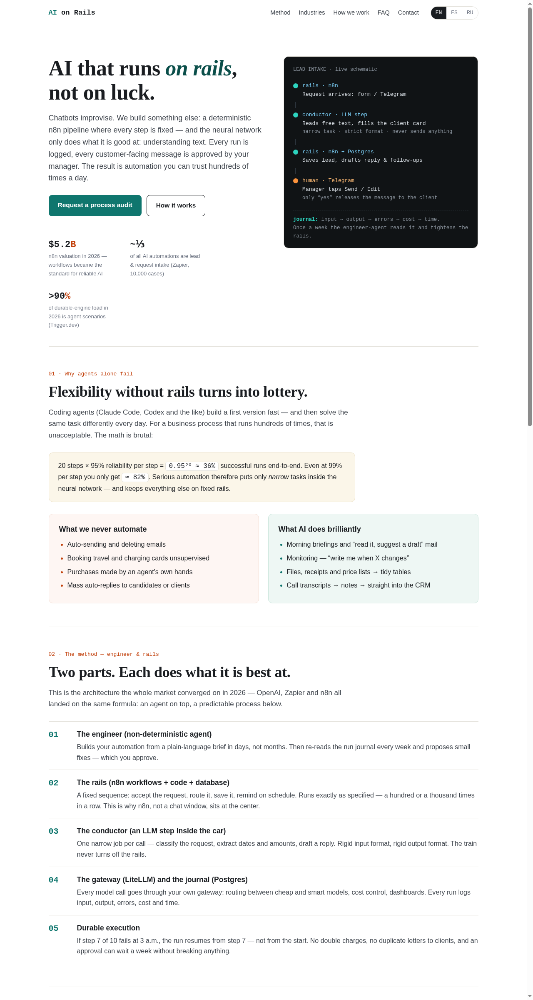
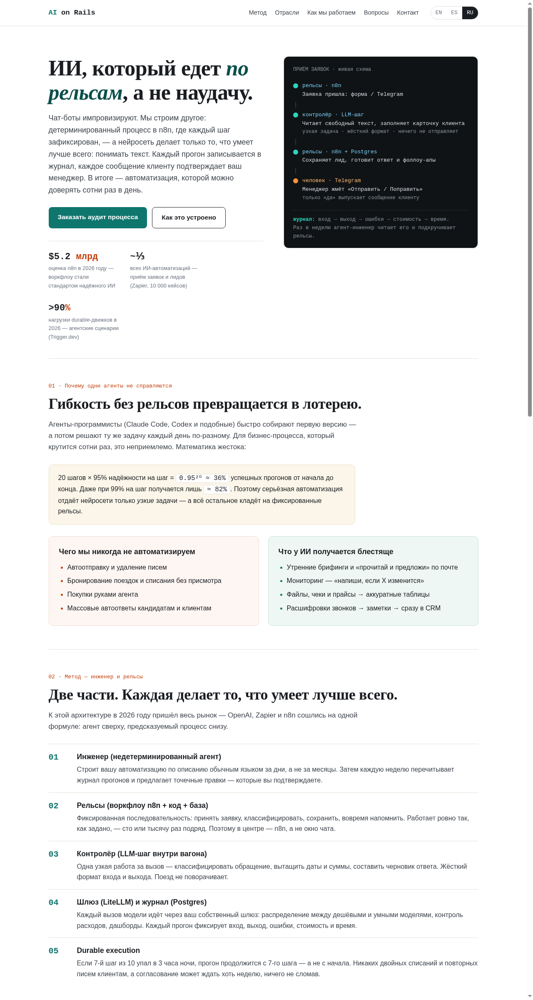

# AI on Rails

Trilingual landing page selling predictable **n8n + LLM automation**
(“engineer & rails” method) with worked examples from three industries.

- `/` — English (default), `es/` — Español, `ru/` — Русский.
- Every page carries a language switch in the header.
- Pure static HTML + one `style.css`. No build step, no JavaScript.

## Preview (how the site looks)

English:



Español:


Русский:



## Local preview

```bash
cd ~/ai-on-rails && python3 -m http.server 8080
# open http://localhost:8080
```

## Deploy

Any push to `main` is published by GitHub Pages within ~1 minute:

```bash
git push origin main
```

## URLs

This is a **project page**, so it lives under your account's Pages domain:

- EN: `https://goswift.org/ai-on-rails/`
- ES: `https://goswift.org/ai-on-rails/es/`
- RU: `https://goswift.org/ai-on-rails/ru/`

(`dbystruev.github.io/ai-on-rails/…` redirects there automatically.)

## Custom domain — fix `goswift.org` DNS (required, ~10 min)

Your account Pages site (`dbystruev.github.io` repo) already has the custom
domain `goswift.org` configured — but the domain currently **does not resolve
(NXDOMAIN)**, so *none* of your Pages URLs work right now, including this new
site. One DNS change fixes everything:

1. At your DNS provider (wherever `goswift.org` is registered), add four
   **A** records for `@` (GitHub Pages IPs — re-check the current list at
   `https://docs.github.com/en/pages/configuring-a-custom-domain-for-your-github-pages-site`
   if this ever stops working):
   ```
   185.199.108.153
   185.199.109.153
   185.199.110.153
   185.199.111.153
   ```
   Optionally also add a **CNAME** `www` → `dbystruev.github.io` so
   `www.goswift.org` works too (GitHub redirects it to the apex).
2. Wait for DNS to propagate (5 min – 24 h), then open
   `https://goswift.org/ai-on-rails/`.
3. HTTPS is issued automatically — in the `dbystruev.github.io` repo go to
   **Settings → Pages** and tick **Enforce HTTPS** once the certificate is
   ready (usually within an hour of DNS going live).

### Verify

```bash
dig +short goswift.org            # expect the four 185.199.x.x IPs
curl -sIL https://goswift.org/ai-on-rails/ | grep -E '^HTTP'  # expect 200s
```

### Want a nicer URL, e.g. `rails.goswift.org`?

That is a second, optional step: add a **CNAME** `rails` →
`dbystruev.github.io` at your DNS provider, then in **this** repo
(`ai-on-rails`) go to **Settings → Pages → Custom domain**, type
`rails.goswift.org`, Save. (Equivalent: commit a file named `CNAME`
containing exactly `rails.goswift.org`.) Then enforce HTTPS here too.

## To customize

- Contact email: search `hello@example.com` in the three `index.html`
  files and replace (add your Telegram next to it — marked in the contact
  section).
